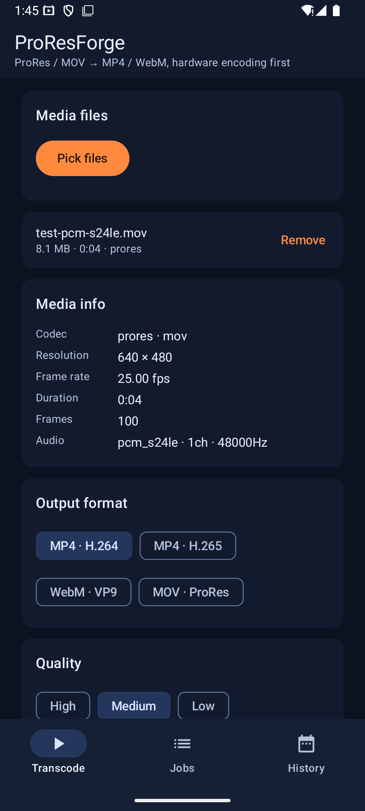
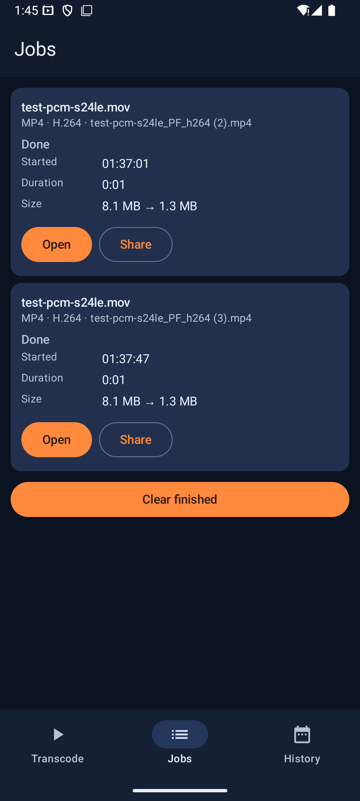
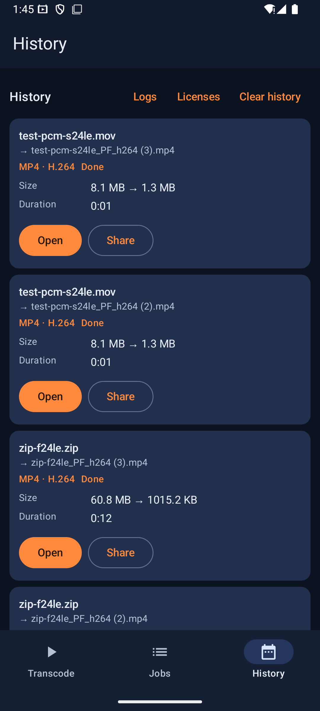

# ProResForge · 转码炉

[](https://github.com/Beiyu114514/ProResForge/releases)
[](#6-许可与合规)
[](https://github.com/Beiyu114514/ProResForge/releases)
[](PRIVACY.md)

把 **MotionCam 拍摄 raw → 转出的 Apple ProRes(.mov/.mxf)** 在 Android 手机上直接转码为
**H.264 / H.265 / VP9 / ProRes 母版**,并可把 **LUT(.cube / .3dl)烘焙进画面**(支持强度 0–100%)。

| 首页(选文件/格式) | 任务页(进度/取消) | 历史页(分享/许可) |
|:---:|:---:|:---:|
|  |  |  |

- 硬件编码优先(`h264_mediacodec` / `hevc_mediacodec`),软件兜底(`libx264` / `libx265`)
- 批量队列:一次选多个文件,后台前台服务逐个转码,通知栏进度,可取消
- SAF + `detachFd` + `pread/pwrite` 自定义 AVIO:**不拷贝、不占双倍空间**,G 级文件也直接读
- LUT 前/后单帧预览(JPEG),压缩前先看效果
- 全 FFmpeg 6.1 本地交叉编译,无任何远程依赖、无隐私上传

## 0. 下载安装

从 [**GitHub Releases**](https://github.com/Beiyu114514/ProResForge/releases/latest) 获取:

| 产物 | 说明 |
|---|---|
| `ProResForge-<版本>.apk` | release 签名直装包,双 ABI(arm64-v8a + armeabi-v7a),约 52 MiB |
| `ProResForge-source-<版本>.zip` | 对应 tag 的完整源码快照(GPL 对应源码,含构建脚本与版本 pin) |

- 要求 Android 7.0+(API 24);arm64 为主目标,32 位设备未经广泛测试
- 下载后核对 SHA-256(发布页附),手机上直接安装(需允许「未知来源」)
- 当前渠道只发 GitHub Releases,不上架 Google Play。
  二进制分发同样走 Releases 而非 GitHub Packages(registry 形态不适配 APK 直发,
  没有为纯二进制引入 Maven/容器包装的必要)

## 1. 功能一览

| 能力 | 说明 |
|---|---|
| 输入 | ProRes 422 / 422 HQ / 422 LT / 422 Proxy / 4444 / 4444 XQ(.mov / .mxf / .mp4 通用) |
| 输入 | **DNG 序列 zip(MotionCam 导出,~900 帧 frame-NNNNN.dng)** → LibRaw 单帧解码;可输出线性或 Apple Log / Rec.2020 |
| 输出 | MP4·H.264 · MP4·H.265(可选 10bit) · WebM·VP9 · MOV·ProRes 422(HQ) 母版 |
| 质量 | 三档预设(高/中/低)→ CRF/CQ;约 20 种分辨率/帧率选项(原始、1080p、720p、50%、25%、60/30/24fps) |
| LUT | `.cube`(3D,任意点数)、`.3dl`;强度 0–100%;自动识别 `LUT_3D_SIZE`;前后对比预览 |
| 音频 | 保留直通(自动加 aac_adtstoasc 等 bsf)/ 重编码 AAC / 丢弃 |
| 方向 | 按 display matrix 自动旋转(ProRes 常见横拍竖存) |
| 色彩 | 输出流写 `bt709` 等 tag;DNG zip 可选内置 Apple Log(Rec.2020)映射;HDR(HLG/PQ)输入给提示,建议先套 tonemap LUT |
| 其它 | 输出 moov 前置(faststart)、队列可取消(整队取消/单个任务取消)、历史记录、分享输出 |

## 2. 架构

```
┌─────────────────────────── 手机端 App(com.proresforge.app) ──────────────────────────┐
│ Compose UI(Home/Jobs/History)                                                         │
│   ├── HomeViewModel:SAF 选文件 → MediaProbe(nativeInfo) → 输出参数 → JobBus.enqueue     │
│   └── TranscodeService(前台服务,foregroundServiceType=mediaProcessing)                 │
│         ├── contentResolver.openFileDescriptor(...).detachFd()   ← 零拷贝 IO            │
│         ├── FFmpeg JNI(libffmpeg-transcode.so)                                          │
│         │     nativeRun / nativeInfo / nativePreview / nativeCancel                   │
│         └── JobStore(kotlinx.serialization, filesDir/jobs.json)                        │
└───────────────────────────────────────────────────────────────────────────────────────┘
                    │ JNI(参数:输入 fd、输出 fd、spec k=v 串)
                    ▼
┌──────────────────────── FFmpeg 6.1(native C) ────────────────────────┐
│ 自定义 AVIOContext(pread/pwrite/seek)                                  │
│   avformat(探测 ProRes) → avcodec(prores 解码, 4 线程)                  │
│   avfilter: buffer → autorotate → scale(lanczos) → setsar → format     │
│            → [split+blend: lut3d(强度<1 混原帧)] → fps                 │
│   avcodec:   h264_mediacodec ─失败→ libx264                            │
│              hevc_mediacodec ─失败→ libx265                            │
│              libvpx-vp9 · prores_ks · aac                              │
│   音频 copy(bsf) / swr→AAC;faststart(moov 前置)                        │
│   进度回调(AttachCurrentThread)+ std::atomic<bool> 取消                │
└───────────────────────────────────────────────────────────────────────┘
```

跨模块唯一契约:`docs/INTERFACES.md`(JNI 签名、spec 键名、数据类、Manifest 权限)。

## 3. 构建(约 3 步)

### 3.1 准备
- Android Studio(建议 Ladybug+,AGP 8.7+)或命令行 Gradle 8.9 + JDK 17
- Android NDK **27.0.12077973**(SDK Manager → NDK;CMake 3.22.1 会随构建自动下载)
- 交叉编译机:Linux/macOS + `cmake pkg-config make git yasm perl python3`

### 3.2 编译 FFmpeg(约 20–40 分钟,8 核)

```bash
export NDK=/path/to/android-ndk-r27        # 或设置 ANDROID_NDK_HOME
bash scripts/build-ffmpeg-android.sh       # 默认 arm64 + arm,生成 app/src/main/cpp/prebuilt/<abi>/{include,lib}
# 只编一个 ABI:
bash scripts/build-ffmpeg-android.sh arm64
# 注:部分文件系统(sdcard/exFAT)不保存可执行位,直接用 bash 调用最稳;若./方式失败,先 chmod +x
```

脚本会交叉编译 x264 / x265 / vpx,再构建 FFmpeg 6.1(`--enable-gpl --enable-version3
--enable-libx264 --enable-libx265 --enable-libvpx --enable-mediacodec --enable-avfilter`),
最后用 NDK toolchain 的 cmake 构建 **LibRaw 0.21.4**(DNG 序列 zip 解码,依赖 NDK sysroot 的
zlib;`LIBRAW_JPEG=1` 才另编 libjpeg-turbo,默认关),按 ABI 装到
`app/src/main/cpp/prebuilt/`。CMakeLists.txt 检测不到产物会给出明确 `FATAL_ERROR` 提示。

### 3.3 构建 APK

```bash
# Android Studio:Open 本目录 → 等 Gradle Sync → Run
./gradlew :app:assembleDebug               # wrapper 已随仓库提供(Gradle 8.9)
                                         # 产物 app/build/outputs/apk/debug/app-debug.apk
```

Release 需自行配签名;当前 `versionName 1.0.0`,未开混淆(proguard-rules.pro 只保 JNI 类)。
ABI 同时打进 `arm64-v8a + armeabi-v7a`;单 ABI 瘦身见 `app/build.gradle.kts` 中的
`defaultConfig.ndk.abiFilters`。

> `.so` 打包无需手工操作:`app/build.gradle.kts` 的 `syncFfmpegJniLibs`(Sync 任务)会把
> CMake 链接图所需的 FFmpeg 运行库从 `src/main/cpp/prebuilt/<abi>/lib/` 展平成
> AGP 的 `jniLibs/<abi>/` 布局再进 APK
> ——也就是说 **3.2 必须先跑**,否则 CMake 配置阶段直接 `FATAL_ERROR`。

### 3.4 契约自检(改 native/文档后跑一遍)

```bash
bash scripts/check-contracts.sh
```

代码是契约的唯一真源:`docs/INTERFACES.md` 是它的投影。该脚本核对 JNI 入口数(6 个)、
CMake 源清单、FFmpeg 运行库清单(7 个,含 `postproc`)、ProRes profile「按名取」有无回潮、
spec 键(27 个)是否与 `strspec.h`/§3 表一致 —— 任一不符即退出码 1,防文档再次漂移。

## 4. 使用

1. 安装后授予通知权限;点「选择文件」可多选 ProRes 素材
2. 选输出格式(MP4·H.264 / MP4·H.265 / WebM·VP9 / MOV·ProRes)、质量档、缩放与帧率
3. 可选:加载 LUT(`sample-luts/` 里有 3 个示例可先推到手机验证),拖动强度条,
   点预览对比 LUT 前后效果
4. 输出目录默认 `Movies/ProResForge`(可改);点「开始转码」
5. 通知栏/任务页看进度,可取消;完成后在历史页打开或分享

## 5. 目录树

```
ProResForge/
├─ LICENSE                        # App 源码 MIT
├─ build.gradle.kts · settings.gradle.kts · gradle.properties
├─ gradle/                        # wrapper(版本随 AGP 升级同步)
├─ docs/
│  ├─ INTERFACES.md               # 跨模块接口契约(JNI/spec/数据类)
│  └─ store-media/                # 应用界面截图
├─ sample-luts/                   # identity/teal-orange/golden-hour 示例 LUT
├─ scripts/
│  ├─ build-ffmpeg-android.sh     # NDK 交叉编译 FFmpeg 6.1 + x264/x265/vpx/LibRaw
│  ├─ check-contracts.sh          # 契约自检:JNI 数/源清单/runtime 库/spec 键 vs INTERFACES
│  ├─ gen_sample_luts.py          # 重新生成示例 LUT
│  ├─ applelog-curve-check.sh     # Apple Log 曲线核对
│  ├─ transcode_harness.cpp · probe_harness.cpp   # native 侧本地测试桩(不入库)
│  └─ ...
└─ app/
   ├─ build.gradle.kts            # app 构建配置(NDK 27 / CMake / Compose)
   └─ src/main/
      ├─ AndroidManifest.xml
      ├─ cpp/
      │  ├─ CMakeLists.txt        # 4 .cpp + FFmpeg/LibRaw 链接;详见契约 §6/§10
      │  ├─ native-lib.cpp        # JNI 入口(6 个函数,契约 §2)
      │  ├─ transcode.cpp/.h      # 转码管线 + CUSTOM_IO(M-1)
      │  ├─ preview.cpp/.h        # 预览/缩略图
      │  ├─ strspec.h             # spec k=v 解析 + 27 键清单(契约 §3)
      │  ├─ dngzip.cpp/.h         # DNG 序列 zip 解码(zlib,封帧+回退)
      │  ├─ dngframeq.h           # 跨线程帧队列
      │  └─ prebuilt/             # FFmpeg/LibRaw 交叉编译产物(.gitignore 不入库)
      │                             #   版本 pin/BUILDINFO 见 prebuilt/README.md
      ├─ java/com/proresforge/app/
      │  ├─ MainActivity.kt · ui/(Home/Jobs/History/ViewModel/theme)
      │  ├─ engine/{FFmpeg,JobBus,TranscodeService,Notifications}.kt
      │  └─ data/{model,FormatCatalog,MediaProbe,LutFile,JobStore,OutputDir,SettingsStore}.kt
      └─ res/                     # 中文默认 + values-en、Material3 主题、自适应图标
```

## 6. 许可与合规

许可结构分两层(与 `app/src/main/assets/licenses/NOTICE.md` 一致,应用内「历史 → 开源许可」可查):

- **App 源码(Kotlin/C++ 本仓库代码):MIT**(`LICENSE`)。
- **发布的 APK 二进制:整体按 GPL-3.0 分发** —— 构建启用 `--enable-gpl
  --enable-version3`(x264/x265 为 GPL 组件),因此对外分发的二进制须遵守
  GPL-3.0。对应源码随每个 Release 以 source zip 形式提供(GPL-3.0 §6(b)
  书面 offer,有效期至 2029-10-10;详见 NOTICE.md §6)。
- 想形成闭源友好构建,仅删除 x264/x265 不够;还需关闭 GPL 选项并重新核对
  FFmpeg、libvpx、libpostproc 与其他依赖的许可证义务。
- DNG 序列 zip 解码器静态链接 **LibRaw 0.21.4**(LGPL-2.1-or-later / CDDL-1.0
  双许可,本分发选用 LGPL-2.1);zlib 来自 NDK sysroot(Zlib);libvpx 为
  BSD-3-Clause。许可证全文随 APK 的 `assets/licenses/` 分发。
- ProRes 解码器 `prores` 由 FFmpeg 原生提供(LGPL/BSD 视版本),不再依赖 Apple 许可条款。
- 隐私:`PRIVACY.md` —— 无 INTERNET 权限、不收集、不上传任何数据。

## 7. 已知限制 & 路线图

- 4K 422 HQ(≈880Mbps)ProRes 解码是纯 CPU,老机器解 4K 可能不足 15fps → 优先硬编+中画质
- `hevc_mediacodec` 10bit 仅部分 SoC 支持;不支持的设备回退 `libx265`(慢,但正确)
- 队列只存在于内存(JobBus):进程被杀后未完成任务不恢复,但已完成的记录已写入历史;
  通知栏/任务页可单个或整队取消
- **DNG 序列 zip 是后台慢活,不是实时**:LibRaw 单线程解 raw + prores_ks,AHD(精细档)
  4K 每帧 1–4s,900 帧约 15–60 分钟;1080p 均衡档约 3–8fps,900 帧 < 20 分钟。
  相机侧导出的 zip 建议直接选「快速/均衡 + 1080p」,界面上有时长预估
- 计划:**TODO** 波形/直方图监看、音轨多轨映射、Hable tonemap 一键加、文件夹批量监听;
  M6 之后再做多线程解马赛克与 MotionCam `.mcraw` 直读(契约 §10)

### DNG 序列 zip 验收口径(`docs/INTERFACES.md` §10.7)

- 输出 `.mov`、`prores_ks profile=hq`(按名)、`yuv422p10le`;输出帧数 == zip 内
  `frame-NNNNN.dng` 帧数(md5 计数);`duration == nb_frames/fps`
- 灰卡/白卡中性片 vs 桌面 LibRaw+ffmpeg 同参数:PSNR ≥ 40dB
- zip → 媒体信息非空(正确的 w/h/nb_frames);非 DNG zip → 「不可解析」
- 预览按帧号取帧(帧号即 seek),JPEG 与转码首帧一致
- arm64 1080p60 900 帧 < 20 分钟;4K 900 帧 < 90 分钟(P50/均衡档)
- 全程内存按分辨率分档:1080p ≤ 400MB / 4K ≤ 500MB(4096×3072 四线程实测 VmHWM 496MB,
  预算 kBudget=1GB 由「单帧峰值 ≈ rgb×2.95+16MB」反推线程数),900 帧无 OOM;取消在帧边界生效(留残片,与既有行为一致)
- 既有 .mov/.mxf 回归用用例不改动地全过

## 8. 反馈与支持

- **Bug / 功能建议**:[Issues](https://github.com/Beiyu114514/ProResForge/issues)
  (报告转码失败请附上 `files/logs/app.log` 的相关段落,取法见下方)
- 应用完全离线、无崩溃上报;排障日志在本机应用私有目录:
  `adb shell run-as com.proresforge.app cat files/logs/app.log`
  (或系统文件选择器授权 `Android/data/com.proresforge.app/files/logs/` 后直接取)
- 安全问题请勿开公开 issue,直接联系维护者

---

实现细节与联调问题请看 `docs/INTERFACES.md`;编译脚本头部有完整参数说明。
